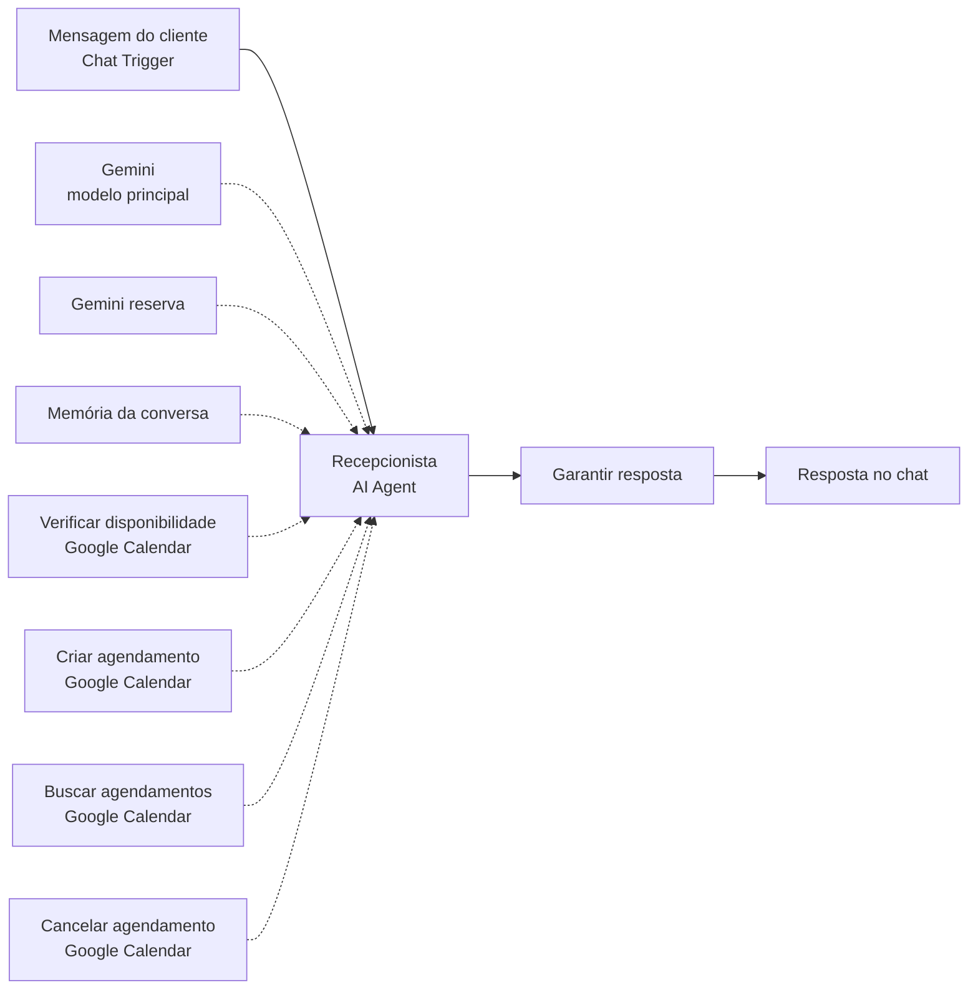

# Agendamento por chat com IA para barbearia (n8n + Gemini + Google Calendar)

Agente de IA que atende clientes da **Doctor Barber**, uma barbearia fictícia, pelo chat: entende o pedido em linguagem natural, pergunta o que falta, confere a agenda no Google Calendar e marca o horário depois da confirmação do cliente. Também cancela e remarca agendamentos feitos na mesma conversa.

> 🎥 Vídeo do fluxo funcionando: (https://youtu.be/O7hVk2k1FHQ)

## O problema

Em barbearias pequenas, o agendamento costuma ser feito por mensagem, manualmente. O dono interrompe o atendimento para responder, confere a agenda de cabeça e às vezes marca dois clientes no mesmo horário. Formulários resolvem parte disso, mas obrigam o cliente a seguir um roteiro rígido.

Este projeto automatiza a conversa inteira: o cliente escreve como escreveria para uma pessoa ("quero cortar o cabelo quarta de tarde") e o agente cuida do resto.

## Como funciona



1. O cliente manda uma mensagem pelo chat do n8n.
2. O agente lê a mensagem junto com o histórico da conversa e o prompt com os dados da barbearia (serviços, preços, horário de funcionamento).
3. Se falta alguma informação (nome, serviço, dia, horário), ele pergunta.
4. Com o pedido completo, ele valida as regras de funcionamento e consulta o Google Calendar.
5. Se o horário está livre, mostra um resumo e pede confirmação. Se está ocupado, sugere horários próximos que estejam livres.
6. Com a confirmação, verifica a agenda de novo e cria o evento com o serviço e o nome do cliente no título.
7. Para cancelar ou remarcar, o agente busca só os eventos marcados naquela conversa (o código da conversa fica gravado no evento), pede confirmação e faz a alteração.

Se o modelo de IA falhar (cota esgotada ou instabilidade), um modelo reserva assume e o cliente nunca vê uma mensagem de erro técnica.

**Dados da Doctor Barber:** corte (30 min, R$ 40), barba (30 min, R$ 30), corte + barba (60 min, R$ 60). Terça a sábado, das 9h às 19h, fuso America/Sao_Paulo.

## Tecnologias

- **[n8n](https://n8n.io/)**: orquestração do fluxo (Chat Trigger, AI Agent, Simple Memory)
- **Google Gemini**: modelo de linguagem do agente (principal + reserva)
- **Google Calendar API**: disponibilidade, criação, busca e cancelamento de eventos, usados como ferramentas do agente

## Como importar

1. No n8n, crie um workflow e use **⋯ → Import from File...** com o arquivo [`workflow/barbearia-agendamento.json`](workflow/barbearia-agendamento.json).
2. Crie as credenciais:
   - **Gemini:** chave de API do [Google AI Studio](https://aistudio.google.com/) nos nós *Google Gemini Chat Model* e *Gemini reserva*.
   - **Google Calendar:** login com Google no nó *Verificar disponibilidade*; depois selecione a mesma credencial e a mesma agenda nos outros três nós do Calendar.
3. Clique em **Open chat** e converse.

O JSON não contém credenciais. O passo a passo completo está em [`docs/guia-de-configuracao.md`](docs/guia-de-configuracao.md).

## Estrutura do repositório

```
├── workflow/
│   └── barbearia-agendamento.json   # workflow para importar no n8n
└── docs/
    ├── guia-de-configuracao.md      # credenciais e explicação de cada nó
    ├── prompt-do-agente.md          # prompt de sistema, para ajustes
    └── conversas-de-teste.md        # roteiros de teste
```

## Próximos passos

- Validar dia e horário com uma ferramenta de código, em vez de depender só do prompt
- Identificar o cliente por telefone, para cancelar ou remarcar em outra conversa
- Memória persistente (Postgres ou Redis)
- Atendimento por WhatsApp ou Telegram usando o mesmo agente

---

Projeto de portfólio de **Vicente André**.
